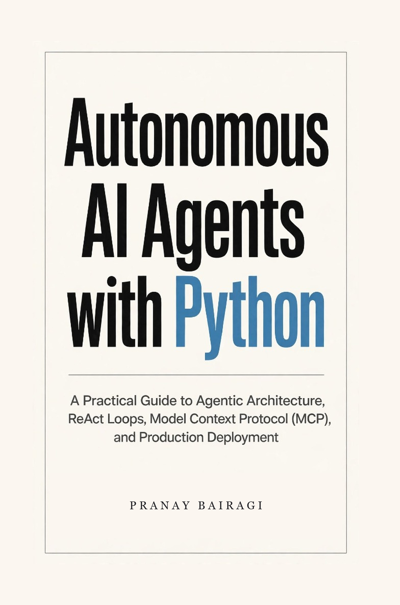
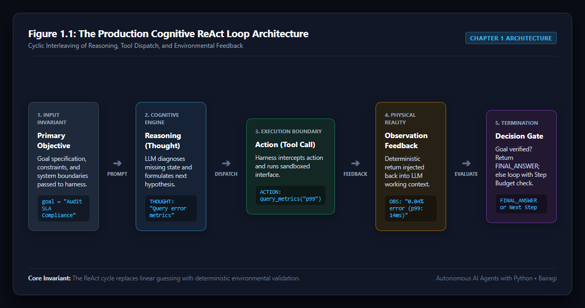
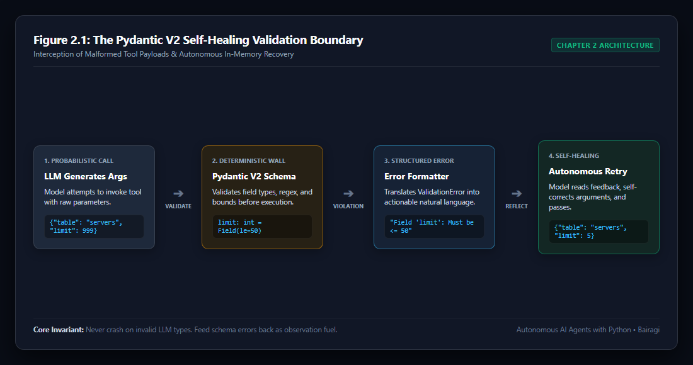
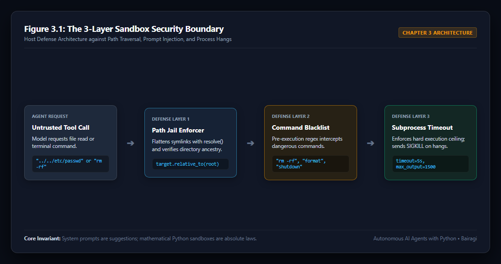
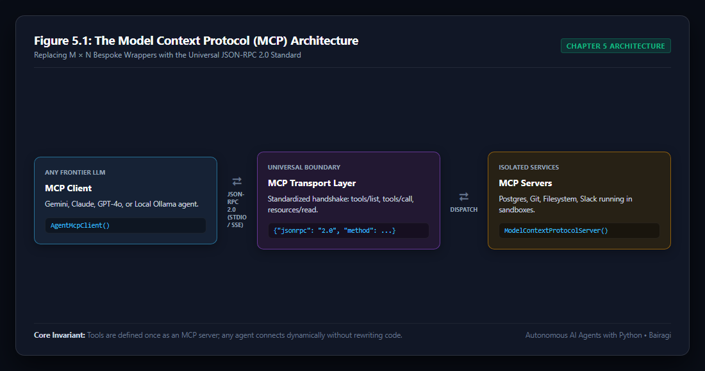
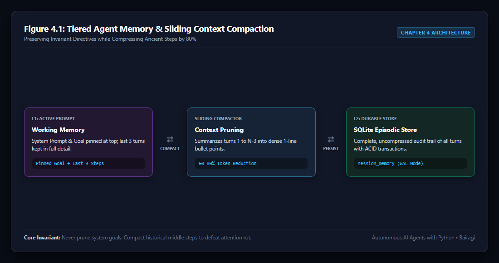
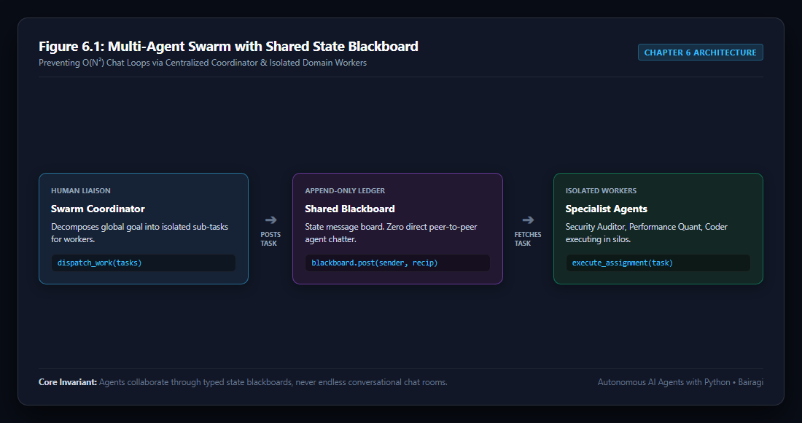
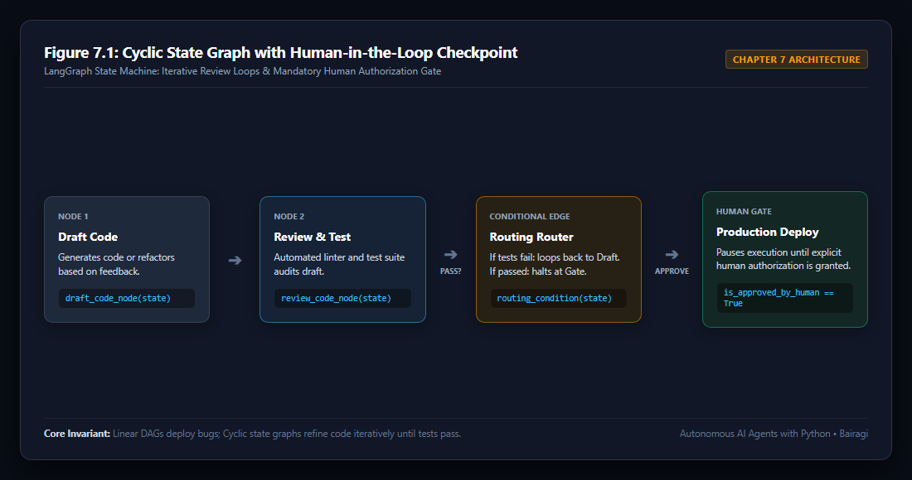
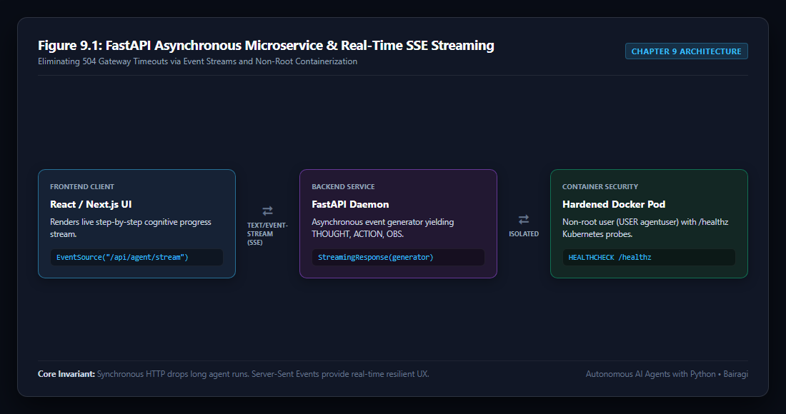
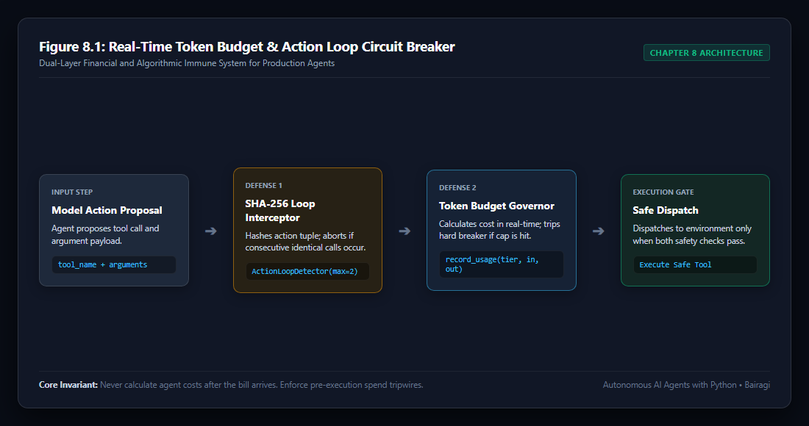

# Autonomous AI Agents with Python 🤖🐍

> **Production-Grade, Framework-Agnostic Blueprints for Resilient Agentic Architectures, ReAct Loops, Model Context Protocol (MCP), and Enterprise Deployment.**

[](https://www.python.org/)
[](LICENSE)
[-orange?logo=amazon)](https://www.amazon.com/dp/B0HS6F1HW6)
[-blue?logo=amazon)](https://www.amazon.com/dp/B0HSQ4C3HX)
[](docker-compose.yml)
[](#the-4-invariant-laws)

<p align="center">
  
</p>

<p align="center">
  <strong>Official Companion Source Code & Production Architecture Repository</strong><br>
  For the book <em>Autonomous AI Agents with Python</em> by <strong>Pranay Bairagi</strong><br>
  Available globally on <strong><a href="https://www.amazon.com/dp/B0HS6F1HW6">Amazon Kindle</a></strong> (ASIN: <code>B0HS6F1HW6</code>, $9.99 USD) &amp; <strong><a href="https://www.amazon.com/dp/B0HSQ4C3HX">Amazon Paperback</a></strong> (ASIN: <code>B0HSQ4C3HX</code>, ISBN: <code>9798144273275</code>, $24.99 USD).
</p>

---

## 🎯 Why This Repository Exists

Most AI agent tutorials on the internet in 2026 are fragile toy scripts: they wrap high-level libraries, hide control flow inside "black-box" frameworks, run in unbounded loops, and crash when an LLM hallucinates an invalid JSON string.

This repository provides **battle-tested, framework-agnostic reference implementations written in pure, native Python**. Every pattern in this repo is engineered to survive real-world production constraints:
- **No Framework Lock-In:** Build native ReAct state machines from first principles.
- **Compiler-Grade Validation:** Enforce type-safe input/output schemas with Pydantic V2.
- **Hardened Execution Boundaries:** Isolate tool execution using OS-level subprocess sandboxes, timeouts, and path jails.
- **Universal Tooling:** Implement Anthropic's **Model Context Protocol (MCP)** for standardized database and API connectivity.
- **Production Infrastructure:** Deploy async FastAPI servers streaming events in real time with Server-Sent Events (SSE) inside hardened Docker containers.

---

## 🏛️ The 4 Invariant Laws of Production Agents

Every module in this codebase adheres strictly to these four architectural invariants:

| Invariant | Production Reality | Implementation in Repo |
| :--- | :--- | :--- |
| **LAW 1** | **An Uncapped Loop is an Uncapped Credit Card.** | Hard step counts, timeout budgets, and token circuit breakers. |
| **LAW 2** | **LLMs Hallucinate Types; Compilers Do Not.** | Pydantic V2 schemas with self-healing feedback validation. |
| **LAW 3** | **System Prompts are Suggestions; Sandboxes are Laws.** | Path jails, unprivileged subprocesses, and command blacklists. |
| **LAW 4** | **Shared State Blackboard Over Chatty Swarms.** | Typed state graphs and centralized coordination over unconstrained multi-agent chat. |

---

## ⚡ Quickstart

### Prerequisites
- Python 3.11+ or 3.12+
- Docker & Docker Compose (optional, for containerized runtime)
- An API Key (OpenAI, Anthropic Claude, or local Ollama)

### 1. Clone & Setup Environment
```bash
git clone https://github.com/pranaybairagi/autonomous-ai-agents.git
cd autonomous-ai-agents

# Create and activate virtual environment
python -m venv venv
source venv/bin/activate  # On Windows: venv\Scripts\activate

# Install dependencies
pip install -r requirements.txt
```

### 2. Configure Environment Variables
```bash
cp .env.example .env
# Add your API keys to .env
# OPENAI_API_KEY=your_key_here
# ANTHROPIC_API_KEY=your_key_here
```

### 3. Run with Docker Compose
```bash
docker compose up --build
```

---

## 🗺️ Chapter Architecture & Code Map

<p align="center">
  
  <br><em>Figure 1.1: The Native Thought-Action-Observation State Machine</em>
</p>

### Part I: Foundations of Autonomy
- **Chapter 1: The Anatomy of an Autonomous Agent**
  - [`chapter_01_agent_anatomy.py`](chapter_01_agent_anatomy.py) — Native ReAct loop (Thought $\rightarrow$ Action $\rightarrow$ Observation) implemented in pure Python without third-party frameworks.
- **Chapter 2: Type-Safe Tool Calling & Self-Healing Schemas**
  - [`chapter_02_structured_tools.py`](chapter_02_structured_tools.py) — Pydantic V2 structured tool dispatching with automated compiler-feedback error recovery.
  - 
- **Chapter 3: Safe Tool Sandboxing & Execution Boundaries**
  - [`chapter_03_sandboxed_tools.py`](chapter_03_sandboxed_tools.py) — Hardened execution sandboxes: path traversal jails, subprocess execution limits, and command blacklists.
  - 

---

<p align="center">
  
  <br><em>Figure 5.1: The Model Context Protocol (MCP) Client-Server Standard</em>
</p>

### Part II: State, Protocols & Orchestration
- **Chapter 4: Memory Systems & Context Optimization**
  - [`chapter_04_memory_systems.py`](chapter_04_memory_systems.py) — 3-tiered memory architecture: working scratchpad, sliding window semantic buffer, and vector/graph long-term recall.
  - 
- **Chapter 5: The Model Context Protocol (MCP)**
  - [`chapter_05_mcp_client_server.py`](chapter_05_mcp_client_server.py) — Building custom MCP servers and client orchestrators using Anthropic's open protocol standard.
- **Chapter 6: Multi-Agent Orchestration & Swarms**
  - [`chapter_06_multi_agent_swarm.py`](chapter_06_multi_agent_swarm.py) — Hierarchical coordinator-worker architectures collaborating over shared blackboard state.
  - 
- **Chapter 7: Graph-Based Workflows with LangGraph**
  - [`chapter_07_graph_workflows.py`](chapter_07_graph_workflows.py) — Cyclic state graphs, deterministic branching, and human-in-the-loop interruption breakpoints.
  - 

---

<p align="center">
  
  <br><em>Figure 9.1: Asynchronous Streaming Runtime with FastAPI and Server-Sent Events</em>
</p>

### Part III: Hardening, Deployment & Production
- **Chapter 8: Guardrails, Token Economics & Cost Optimization**
  - [`chapter_08_guardrails_cost.py`](chapter_08_guardrails_cost.py) — Dynamic token tracking, rate limiters, fallback circuit breakers, and semantic caching.
  - 
- **Chapter 9: Production Deployment: FastAPI & Docker**
  - [`chapter_09_production_deployment.py`](chapter_09_production_deployment.py) — Asynchronous REST server with real-time SSE streaming for live agent reasoning traces.
  - [`Dockerfile`](Dockerfile) & [`docker-compose.yml`](docker-compose.yml) — Production-hardened container blueprint.
- **Chapter 10: Capstone Project: Autonomous Market Intelligence Agent**
  - [`chapter_10_market_intelligence_agent.py`](chapter_10_market_intelligence_agent.py) — End-to-end multi-tool research agent integrating web search, financial analysis, synthesis, and PDF reporting.

---

## 📖 The Complete Book

This repository serves as the official companion codebase for the comprehensive handbook:

### **Autonomous AI Agents with Python**
*A Practical Guide to Agentic Architecture, ReAct Loops, Model Context Protocol (MCP), and Production Deployment*  
**By Pranay Bairagi**

Inside the book, you will find:
- Complete step-by-step mathematical and conceptual breakdowns of each architecture.
- 10 real-world **Production War Stories & Post-Mortems** (including the *3:14 AM Infinite Refund Cascade* and the *Recursive JSON Trap*).
- Comprehensive production readiness checklists and anti-pattern breakdowns for senior software architects.

👉 **Get Your Copy on Amazon:**
- **Kindle eBook Edition:** [Available on Amazon ($9.99)](https://www.amazon.com/dp/B0HS6F1HW6) (ASIN: `B0HS6F1HW6`)
- **Paperback Physical Edition:** [Available on Amazon ($14.99 / $24.99)](https://www.amazon.com/dp/B0HS6F1HW6) (ISBN: `9798144273275`)

---

## 👨‍💻 About the Author

**Pranay Bairagi** is an AI systems architect and distributed infrastructure engineer who designs resilient, production-grade autonomous agent architectures and high-throughput Python backend systems. Having witnessed firsthand the catastrophic failure modes of fragile "toy agents" in real-world deployments—from unbounded recursive loops to runaway cloud billing—his work focuses on bridging the critical divide between probabilistic LLM reasoning and hardened deterministic software engineering.

---

## 📜 License

This companion code repository is open-sourced under the **[MIT License](LICENSE)**. You are free to use, modify, and integrate these patterns into your personal and commercial enterprise projects.
